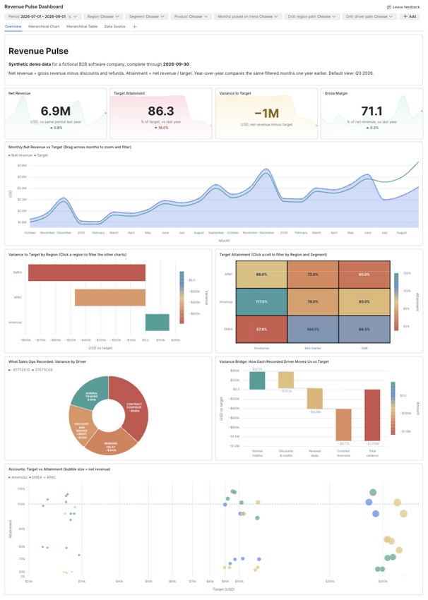
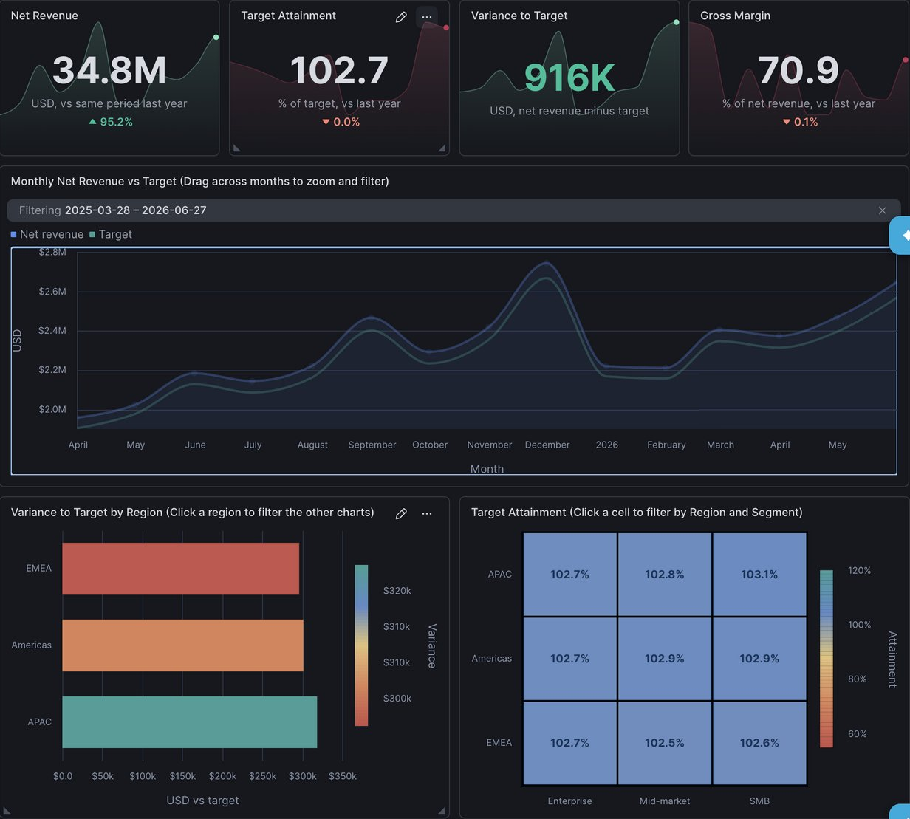
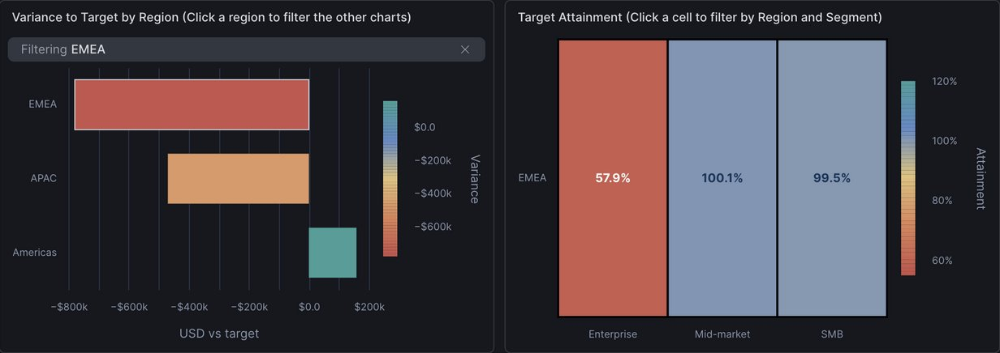
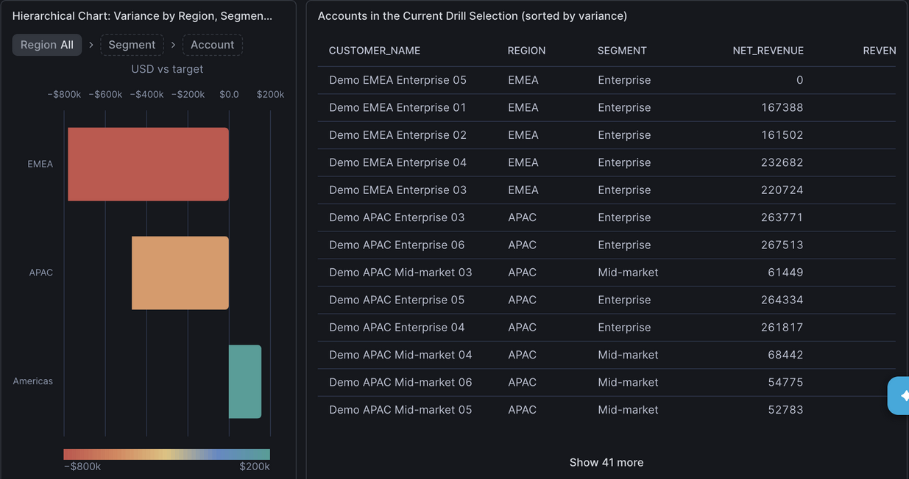
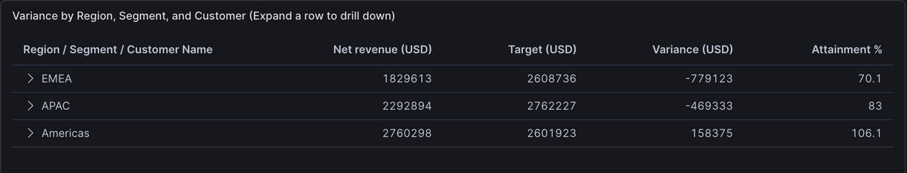
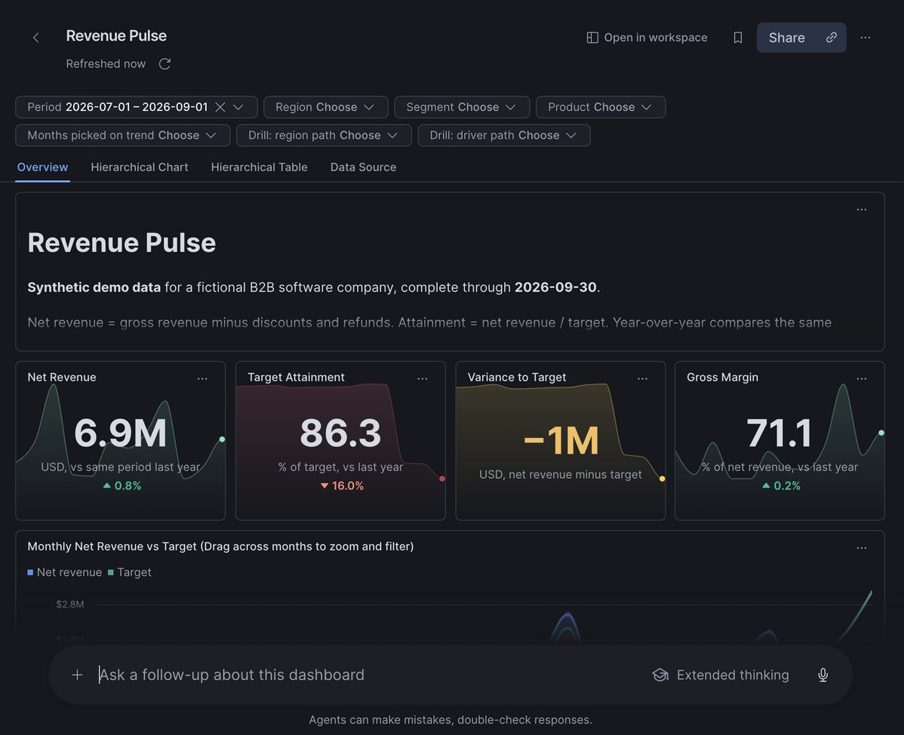
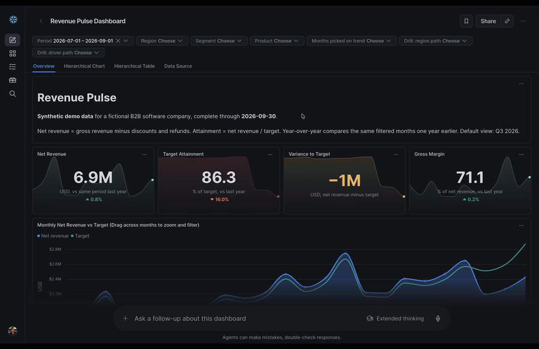

author: Chanin Nantasenamat
id: getting-started-with-snowflake-dashboards
categories: snowflake-site:taxonomy/solution-center/certification/quickstart, snowflake-site:taxonomy/product/analytics
language: en
summary: Load a synthetic revenue dataset with one SQL file, open a pre-made Snowflake Dashboards file, and explore filters, drilldown, and chart actions in a few minutes.
environments: web
status: Draft
feedback link: https://github.com/Snowflake-Labs/sfquickstarts/issues
fork repo link: https://github.com/sfc-gh-cnantasenamat/sfguide-getting-started-with-snowflake-dashboards

# Getting Started with Snowflake Dashboards

## Overview

A revenue number that misses target raises questions right away. Which region is behind? Which segment? Which accounts? On many teams the answers live in exported spreadsheets or static report decks. They go stale as soon as the data changes, and every follow-up question means another export or another request to an analyst.

[Snowflake Dashboards](https://docs.snowflake.com/en/LIMITEDACCESS/cowork-dashboards) (public preview) give the team one shared source of truth that they can also talk to. Analysts build a dashboard by describing it to Cortex Code (CoCo), then share it with the right roles. Anyone with access can open it in Snowflake CoWork and ask it questions: summarize what it shows, explain what drove a change, or narrow it to one segment. The answers come from the same governed data the charts use. That data never leaves Snowflake, and your existing row access and masking policies still apply.

Under the hood, a dashboard is a single `.dash` file in Snowsight Workspaces. Each tile runs live SQL against tables or a semantic view in your account. Filters, chart actions, and hierarchy drilldowns take you from a headline number to the rows behind it without leaving the page.

The dashboard we're building is called **Revenue Pulse**. It runs on synthetic data for a fictional B2B software company: 54 accounts, 3 product lines, and 24 months of revenue through September 30, 2026. The data has a story built in. Q3 2026 revenue is $1.09M behind target, and most of the gap sits in EMEA Enterprise.
### What You'll Learn
- How to load a small demo dataset and semantic view with one SQL file
- How to open a `.dash` file in Snowsight Workspaces
- How filters, brushing, click-to-filter, and hierarchy drilldown work in a dashboard
- How to publish a dashboard to Snowflake CoWork and ask follow-up questions about it

### What You'll Build
You'll set up the data and deploy a ready-made dashboard in your own account, so you get value from it right away:

1. **Get the files:** download three files and point them at a schema you already have.
2. **Load the data:** run one SQL file that loads a small synthetic dataset and a semantic view in about 10 seconds.
3. **Deploy the dashboard:** upload the dashboard file to Workspaces and open it.
4. **Investigate the shortfall:** brush a date range on the trend, click a region to filter every chart, and drill from region to segment to account.
5. **Ask why in CoWork:** publish the dashboard to Snowflake CoWork and ask why the numbers moved.
6. **Clean up:** run a cleanup script that removes everything.

The result is a four-tab Revenue Pulse dashboard running on live queries. The tabs are **Overview**, **Hierarchical Chart**, **Hierarchical Table**, and **Data Source**.



### What You'll Need
- Access to a [Snowflake account](https://signup.snowflake.com/?utm_source=snowflake-devrel&utm_medium=developer-guides&utm_cta=developer-guides)
- An existing schema you can create objects in, and a warehouse you can use. Your role needs `USAGE` on the database and schema, plus `CREATE TABLE` and `CREATE SEMANTIC VIEW` on the schema. If your role owns the schema, it already has these. The same role runs the cleanup
- Access to [Snowflake Dashboards](https://docs.snowflake.com/en/LIMITEDACCESS/cowork-dashboards) (public preview) in Snowsight Workspaces

Everything runs in Snowsight. You don't need Python, a CLI, or a Git integration.

## Get the Files

The three files you need are in the `getting-started/` folder of the [companion repository](https://github.com/sfc-gh-cnantasenamat/getting-started-with-snowflake-dashboards/tree/main/getting-started):

| File | What it does |
|---|---|
| [`setup.sql`](https://github.com/sfc-gh-cnantasenamat/getting-started-with-snowflake-dashboards/blob/main/getting-started/setup.sql) | Creates three tables of synthetic data and the `REVENUE_SEMANTIC_VIEW` semantic view in your schema |
| [`revenue_pulse.dash`](https://github.com/sfc-gh-cnantasenamat/getting-started-with-snowflake-dashboards/blob/main/getting-started/revenue_pulse.dash) | The finished dashboard: tiles, filters, layout, and SQL in one file |
| [`cleanup.sql`](https://github.com/sfc-gh-cnantasenamat/getting-started-with-snowflake-dashboards/blob/main/getting-started/cleanup.sql) | Drops the four objects `setup.sql` created, for when you're done |

On each file's GitHub page, select **Download raw file**.

### Point the Files at Your Schema

`TEMP` and `CNANTASENAMAT` are the author's own database and schema, used here as placeholders. Replace them with a database and schema of your choice that you can create objects in. Do this before uploading the files.

1. In `setup.sql` and `cleanup.sql`, replace `TEMP` and `CNANTASENAMAT` in the two `USE` lines near the top. Each line has a comment marking what to replace:

   ```sql
   USE DATABASE TEMP;   -- Replace TEMP with your own database
   USE SCHEMA CNANTASENAMAT;   -- Replace CNANTASENAMAT with your own schema in that database
   ```

   For example, `USE DATABASE ANALYTICS;` and `USE SCHEMA MY_SANDBOX;`. Everything after these lines uses names relative to that schema.
2. In `revenue_pulse.dash`, replace every `TEMP.CNANTASENAMAT` with your own `DATABASE.SCHEMA`, for example `ANALYTICS.MY_SANDBOX`. The dashboard's queries use fully qualified names, so they work for anyone you share it with.

> Pick a schema that doesn't already contain tables named `CUSTOMERS`, `PRODUCTS`, or `REVENUE_MONTHLY`, or a semantic view named `REVENUE_SEMANTIC_VIEW`. The setup replaces objects with those names.

## Load the Data

1. In Snowsight, go to **Projects » Workspaces**.
2. In **My Workspace**, select **+ Add New » Upload Files** and upload `setup.sql`.
3. Open `setup.sql`. In the editor, pick your role and a warehouse.
4. Select **Run All**.

The script finishes in about 10 seconds. Its last statement returns one row:

| CUSTOMERS | PRODUCTS | REVENUE_ROWS |
|---|---|---|
| 54 | 3 | 3888 |

If you see those numbers, the data is ready. The script is safe to run again: it replaces the tables and semantic view each time, and keeps any grants you've added to them.

> **Note:** The revenue rows are packed into one `INSERT` to keep the file small. You don't need to read it. The table definitions at the top and the semantic view at the bottom are the parts worth a look.

## Open the Dashboard

1. Select **+ Add New » Upload Files** again and upload `revenue_pulse.dash`.
2. Open `revenue_pulse.dash`. Snowsight renders it as a dashboard rather than as text.
3. Select **Run all** if the tiles don't load on their own.

The KPI row shows the Q3 2026 headline: net revenue of **$6.9M**, up 0.8% year over year, **86.3%** target attainment, a variance of about **−$1.09M** (the card rounds it to −$1M), and 71% gross margin.

That's the whole setup. Everything from here is exploring.

## Explore the Dashboard

Try each of these on the **Overview** tab, and clear the selection before the next one.

### Brush the Trend
Drag across a range of months on **Monthly Net Revenue vs Target**. The chart zooms to those months, and the KPI cards, regional bars, and heatmap recalculate for the range. Clear the **Filtering** chip on the tile to undo it.



### Click a Region
Click the **EMEA** bar on **Variance to Target by Region**. The other tiles filter to EMEA, where attainment drops to about 70%. Clear **Drill: region path** at the top to reset.



### Click a Heatmap Cell
On **Target Attainment**, the darkest cell is EMEA Enterprise at **57.9%**. Click it to filter the rest of the dashboard to that region and segment.

### Drill the Hierarchy
Open the **Hierarchical Chart** tab. Click **EMEA**, then **Enterprise**, to reach its six accounts. The largest miss is Demo EMEA Enterprise 05, at about −$349K. Use the level trail to return to the top.



The **Hierarchical Table** tab shows the same region › segment › account path as an expandable grid.



### Use the Header Filters
Set **Region = EMEA** and **Segment = Enterprise** from the filter bar. These filters apply across every tab, which makes them the quickest way to compare one slice against another.

## Ask Why in CoWork

The dashboard has shown you where the gap is: EMEA Enterprise, and three of its accounts in particular. The next question is why. Publish the dashboard to [Snowflake CoWork](https://docs.snowflake.com/en/user-guide/snowflake-cortex/snowflake-cowork) and you can ask that question in plain language, right next to the charts. Anyone you share it with can do the same.

### Publish the Dashboard

1. With `revenue_pulse.dash` open, select **Share**.
2. Add a role with **Can view** access, then publish. Your own role works; add a teammate's role too if you want them to see it.
3. Open **Artifacts** in CoWork and select **Revenue Pulse**.

Viewers run the dashboard with their own privileges, so their role needs `SELECT` on the three tables and the semantic view, plus a warehouse. Publishing needs the `MANAGE ACCESS ON DASHBOARD ARTIFACTS` privilege, which is [granted to `PUBLIC` by default](https://docs.snowflake.com/en/release-notes/bcr-bundles/un-bundled/bcr-manage-access-dashboard-artifacts).



### Ask a Follow-Up Question

In the box below the dashboard, ask:

```
Why is EMEA Enterprise behind target in Q3 2026? Quantify the drivers.
```

CoWork runs queries against the same data and answers in a side panel, with a table of the drivers behind the miss. In the run below, it found EMEA Enterprise finished Q3 2026 about $779K below target, at 57.9% attainment. Renewal delays explained about 44% of the shortfall, a contract downsize about 33%, and discounts and service credits about 23%. Your answer may be worded differently, but the numbers come from the same data.



Try a follow-up of your own, such as which accounts to call first, or how EMEA Enterprise compares with the same quarter last year.

## Clean Up

When you're done:

1. Remove the dashboard's roles in **Share** and delete the Revenue Pulse artifact in CoWork.
2. Upload `cleanup.sql`, open it, and select **Run All** with the same role you used for `setup.sql`. It drops the four objects the setup created and leaves your schema in place:

```sql
USE DATABASE TEMP;   -- Replace TEMP with your own database
USE SCHEMA CNANTASENAMAT;   -- Replace CNANTASENAMAT with your own schema in that database

DROP SEMANTIC VIEW IF EXISTS REVENUE_SEMANTIC_VIEW;
DROP TABLE IF EXISTS REVENUE_MONTHLY;
DROP TABLE IF EXISTS PRODUCTS;
DROP TABLE IF EXISTS CUSTOMERS;
```

3. Delete `setup.sql`, `revenue_pulse.dash`, and `cleanup.sql` from your workspace.

## Conclusion And Resources

You loaded a dataset, deployed a dashboard file, traced a $1.09M revenue gap to EMEA Enterprise, and asked CoWork why it happened. The `.dash` file you opened holds every tile, filter, chart action, and SQL query, so it's easy to version, share, and reuse.

### What You Learned
- One SQL file can set up the tables and semantic view a dashboard needs
- A `.dash` file opens in Workspaces as a working dashboard
- Brushing, click-to-filter, and hierarchy drilldown let you move from a headline number to the accounts behind it
- Published dashboards run with each viewer's own privileges
- In CoWork, you can ask follow-up questions about a dashboard and get answers from the same data

### Related Resources
- [Dashboards in Snowflake CoWork](https://docs.snowflake.com/en/LIMITEDACCESS/cowork-dashboards)
- [Workspaces](https://docs.snowflake.com/en/user-guide/ui-snowsight/workspaces)
- [Snowflake semantic views](https://docs.snowflake.com/en/user-guide/views-semantic/overview)
- [Artifacts in Snowflake CoWork](https://docs.snowflake.com/en/user-guide/snowflake-cortex/snowflake-cowork/artifacts)
